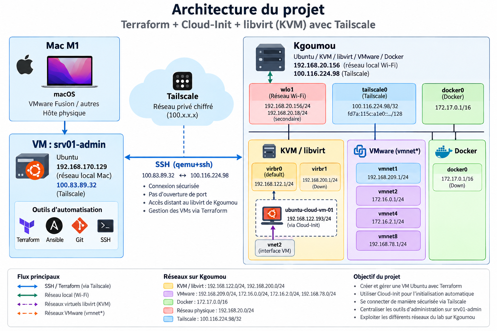
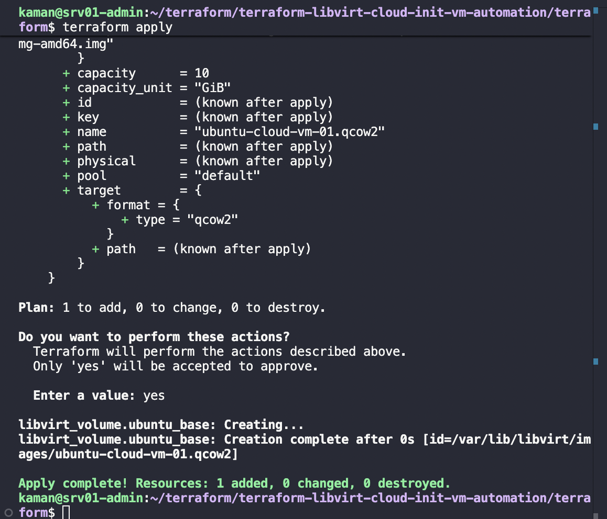
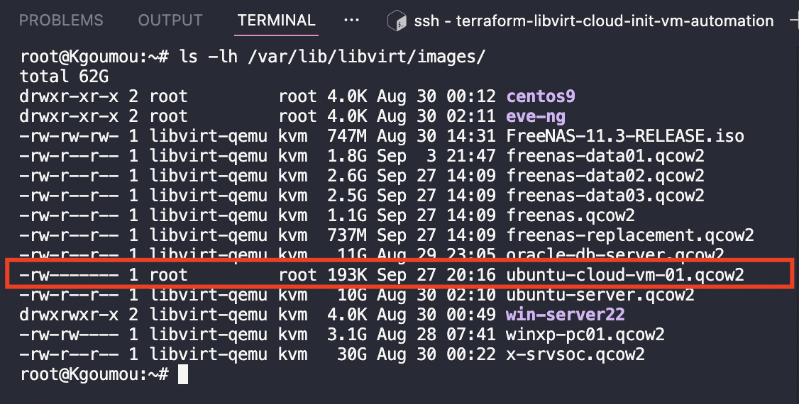
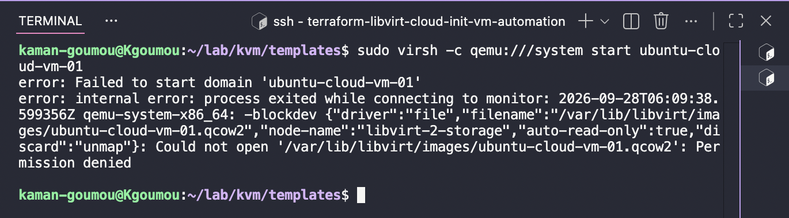
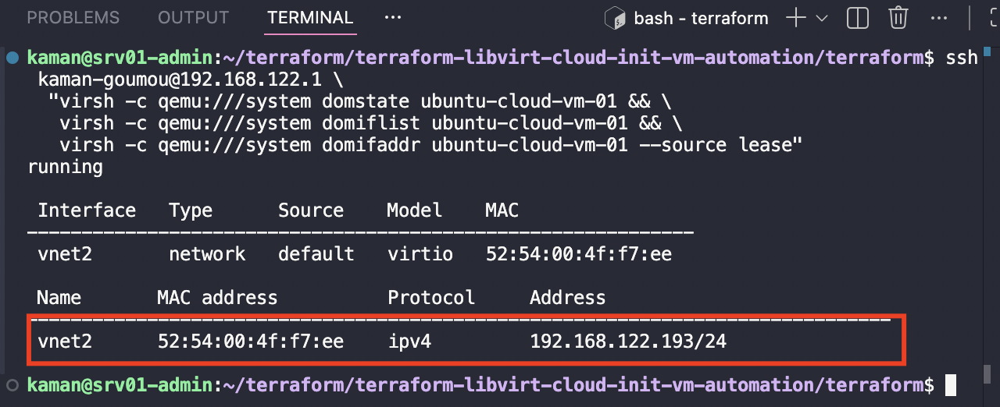
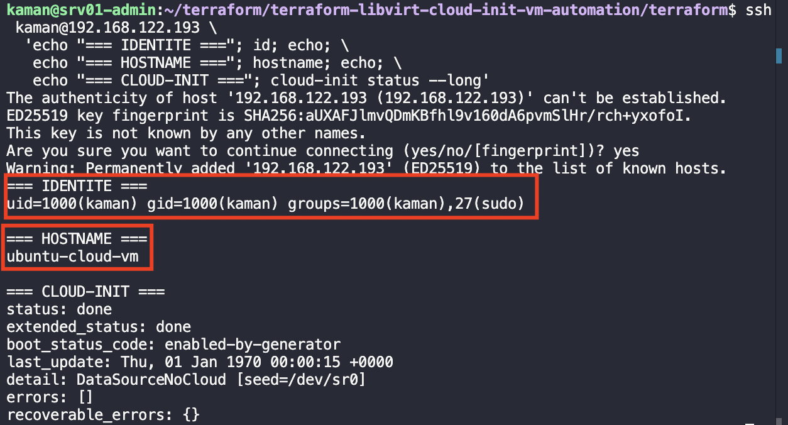

# Automatisation de VM KVM/libvirt avec Terraform et Cloud-Init

<div align="center">



**Terraform + Cloud-Init + libvirt**

*Automatisation du déploiement de VM Ubuntu sur KVM/libvirt*

</div>

## 1. Présentation du projet

Ce projet a pour objectif d'automatiser le déploiement et la configuration initiale d'une machine virtuelle Ubuntu sur une infrastructure KVM/libvirt distante à l'aide de Terraform et Cloud-Init.

L'environnement d'administration est `srv01-admin`, une machine virtuelle utilisée pour exécuter Terraform et piloter l'infrastructure distante.

L'hôte KVM/libvirt cible est `Kgoumou`.

### Architecture générale

```text
Mac M1
   │
   │
   ▼
srv01-admin
Ubuntu Server 24.04.5 LTS
   │
   │ Terraform
   │ SSH / Ed25519
   ▼
Kgoumou
Ubuntu 24.04.5 LTS
KVM / libvirt
   │
   ├── ubuntu-cloud-vm-01
   │      ├── 2 vCPU
   │      ├── 2048 MiB RAM
   │      ├── x86_64 / Q35
   │      ├── vda → QCOW2 / VirtIO
   │      ├── sda → Cloud-Init ISO
   │      └── vnet → default / VirtIO
   │
   └── Ubuntu Cloud Image
          └── noble-server-cloudimg-amd64.img
```

Le projet a été construit progressivement : chaque étape a été exécutée, validée puis documentée avant de poursuivre.

---

## 2. Objectifs du projet

Les objectifs sont les suivants :

- automatiser le déploiement d'une VM avec Terraform ;
- utiliser une Ubuntu Cloud Image comme base ;
- utiliser Cloud-Init pour l'initialisation de la VM ;
- automatiser la création de l'utilisateur et de la clé SSH ;
- utiliser KVM/libvirt comme infrastructure de virtualisation ;
- piloter libvirt à distance depuis `srv01-admin` ;
- utiliser un backing store QCOW2 ;
- rendre le déploiement reproductible ;
- valider le fonctionnement réel de la VM ;
- documenter les problèmes rencontrés et leurs solutions ;
- conserver une procédure suffisamment détaillée pour reproduire le projet.

---

## 3. Architecture du projet

```text
terraform-libvirt-cloud-init-vm-automation/
│
├── README.md
├── .gitignore
│
├── cloud-init/
│   ├── meta-data
│   ├── user-data
│   └── seed.iso
│
├── docs/
│   └── images/
│       ├── 12-08-terraform-apply-volume-created.png
│       ├── 12-09-volume-on-kgoumou.png
│       ├── 14-05-error-source-volume-permission-denied.png
│       ├── 15-02-vm-network-ip.png
│       ├── 15-04-cloud-init-validation.png
│       └── project-architecture.png
│
├── images/
│   └── noble-server-cloudimg-amd64.img
│
├── scripts/
│
└── terraform/
    ├── cloudinit.tf
    ├── domain.tf
    ├── provider.tf
    ├── versions.tf
    └── volume.tf
```

Les fichiers générés tels que `.terraform/`, les fichiers Terraform State, les ISO et les images de VM sont exclus du dépôt Git avec `.gitignore`.

---

# 4. Outils nécessaires à l'automatisation

## 4.1 Environnement d'administration

La machine `srv01-admin` dispose notamment de :

| Outil             | Version |
| ----------------- | ------: |
| Terraform         |  1.16.3 |
| Ansible           |  2.16.3 |
| Cloud-Init        |    26.1 |
| OpenSSH           |   9.6p1 |
| Git               |  2.43.0 |
| libvirt-clients   |  10.0.0 |
| virtinst          |   4.1.0 |
| cloud-image-utils |  0.33-1 |
| qemu-img          |   8.2.2 |

## 4.2 Installation des outils complémentaires

Les outils libvirt et Cloud-Init ont été installés avec :

```bash
sudo apt update
sudo apt install -y libvirt-clients virtinst cloud-image-utils
```

Les commandes suivantes ont ensuite été vérifiées :

```bash
virsh --version
virt-install --version
command -v cloud-localds
qemu-img --version
```

Résultats :

```text
libvirt     : 10.0.0
virt-install: 4.1.0
cloud-localds: /usr/bin/cloud-localds
qemu-img    : 8.2.2
```

La section 4 est validée.

---

# 5. Préparation et initialisation de Terraform

## 5.1 Provider utilisé

Le projet utilise :

```text
dmacvicar/libvirt
```

Version :

```text
0.9.9
```

Terraform minimal requis :

```text
>= 1.16.0
```

## 5.2 Configuration

Le fichier `terraform/versions.tf` contient :

```hcl
terraform {
  required_providers {
    libvirt = {
      source  = "dmacvicar/libvirt"
      version = "0.9.9"
    }
  }

  required_version = ">= 1.16.0"
}
```

## 5.3 Initialisation

Depuis `terraform/` :

```bash
terraform init
```

Le provider `dmacvicar/libvirt` version `0.9.9` a été installé et verrouillé dans :

```text
terraform/.terraform.lock.hcl
```

Validation :

```bash
terraform providers
```

Résultat :

```text
provider[registry.terraform.io/dmacvicar/libvirt] 0.9.9
```

La section 5 est validée.

---

# 6. Environnement cible

## 6.1 Serveur KVM/libvirt

L'hôte cible est :

```text
Hostname     : Kgoumou
OS           : Ubuntu 24.04.5 LTS
Architecture : x86_64
Kernel       : 7.0.0-34-generic
libvirt      : 10.0.0
```

Adresse utilisée par Terraform :

```text
192.168.122.1
```

## 6.2 Pools libvirt

Les pools présents sur Kgoumou comprennent notamment :

```text
centos9
default
eve-ng
ISO
win-server22
```

Le projet utilise le pool :

```text
default
```

## 6.3 Réseaux libvirt

Les réseaux disponibles comprennent :

```text
default
isp2
```

Le projet utilise :

```text
default
```

La section 6 est validée.

---

# 7. Architecture de connexion Terraform vers libvirt

Terraform est exécuté depuis `srv01-admin`.

```text
srv01-admin
    │
    │ SSH
    ▼
Kgoumou
192.168.122.1
    │
    ▼
qemu:///system
    │
    ▼
libvirt / QEMU
```

## 7.1 Validation de libvirt

L'accès au contexte système a été validé avec :

```bash
virsh -c qemu+ssh://kaman-goumou@192.168.122.1/system list --all
```

La commande permet de récupérer les machines virtuelles présentes sur Kgoumou.

## 7.2 Droits

Le compte `kaman-goumou` dispose des droits nécessaires pour utiliser libvirt.

Le socket système est associé au groupe `libvirt` :

```text
/run/libvirt/libvirt-sock
```

## 7.3 Architecture retenue

La connexion Terraform utilise :

```text
qemu+ssh://kaman-goumou@192.168.122.1/system
```

La section 7 est validée.

---

# 8. Configuration du provider Terraform

## 8.1 Première configuration

La première configuration était :

```hcl
provider "libvirt" {
  uri = "qemu+ssh://kaman-goumou@192.168.122.1/system"
}
```

La syntaxe Terraform était valide, mais l'authentification SSH utilisée par le provider a échoué.

Erreur rencontrée :

```text
ssh: handshake failed
no supported methods remain
```

Une tentative avec `qemu+sshcmd` a également échoué.

## 8.2 Création d'une clé dédiée

Afin de séparer l'authentification Terraform des autres clés SSH, une clé dédiée a été créée :

```bash
ssh-keygen -t ed25519 \
  -f ~/.ssh/terraform_libvirt_ed25519 \
  -C "terraform-libvirt@srv01-admin"
```

La clé publique a été installée sur Kgoumou :

```bash
ssh-copy-id \
  -i ~/.ssh/terraform_libvirt_ed25519.pub \
  kaman-goumou@192.168.122.1
```

Validation :

```bash
ssh \
  -i ~/.ssh/terraform_libvirt_ed25519 \
  -o IdentitiesOnly=yes \
  kaman-goumou@192.168.122.1 \
  'id && virsh -c qemu:///system uri'
```

## 8.3 Configuration finale

Le fichier `terraform/provider.tf` contient finalement :

```hcl
provider "libvirt" {
  uri = "qemu+ssh://kaman-goumou@192.168.122.1/system?sshauth=privkey&keyfile=/home/kaman/.ssh/terraform_libvirt_ed25519"
}
```

Cette configuration est la configuration de référence du projet.

---

# 9. Préparation de l'image Ubuntu Cloud

L'image utilisée est :

```text
noble-server-cloudimg-amd64.img
```

Elle correspond à l'image Ubuntu 24.04 LTS AMD64.

L'image a été vérifiée comme étant :

```text
Format       : qcow2
Virtual size : 3.5 GiB
Disk size    : environ 597 MiB
Corrupt      : false
```

Elle a ensuite été placée directement sur Kgoumou :

```text
/var/lib/libvirt/images/base/noble-server-cloudimg-amd64.img
```

La lecture par le processus libvirt a été validée :

```bash
sudo -u libvirt-qemu \
  test -r /var/lib/libvirt/images/base/noble-server-cloudimg-amd64.img \
  && echo "READ_OK"
```

Résultat :

```text
READ_OK
```

La section 9 est validée.

---

# 10. Configuration Cloud-Init

## 10.1 `user-data`

Le fichier `cloud-init/user-data` contient notamment :

```yaml
#cloud-config

hostname: ubuntu-cloud-vm

users:
  - name: kaman
    groups: sudo
    shell: /bin/bash
    sudo: ALL=(ALL) NOPASSWD:ALL
    ssh_authorized_keys:
      - SSH_PUBLIC_KEY

ssh_pwauth: false
disable_root: true

package_update: false
package_upgrade: false
```

La clé publique a été injectée dans le fichier avant génération du support Cloud-Init.

## 10.2 `meta-data`

```yaml
instance-id: ubuntu-cloud-vm-01
local-hostname: ubuntu-cloud-vm
```

## 10.3 Génération du support Cloud-Init

Le support a été généré avec :

```bash
cloud-localds \
  cloud-init/seed.iso \
  cloud-init/user-data \
  cloud-init/meta-data
```

Le support obtenu est une ISO `cidata`.

La section 10 est validée.

---

# 11. Préparation du stockage Terraform

## 11.1 Image de base

L'image de base est présente sur Kgoumou :

```text
/var/lib/libvirt/images/base/noble-server-cloudimg-amd64.img
```

## 11.2 Volume système

Le fichier `terraform/volume.tf` contient la configuration finale :

```hcl
resource "libvirt_volume" "ubuntu_os" {
  name = "ubuntu-cloud-vm-01.qcow2"
  pool = "default"

  capacity      = 10
  capacity_unit = "GiB"

  target = {
    format = {
      type = "qcow2"
    }
  }

  backing_store = {
    path = "/var/lib/libvirt/images/base/noble-server-cloudimg-amd64.img"

    format = {
      type = "qcow2"
    }
  }
}
```

Architecture :

```text
noble-server-cloudimg-amd64.img
             │
             │ backing_store
             ▼
ubuntu-cloud-vm-01.qcow2
             │
             ▼
          VM Ubuntu
```

Cette configuration est la configuration finale retenue.

---

# 12. Création et validation du volume système

## 12.1 Première approche

Une première approche utilisait `create.content.url`.

Elle a échoué lorsque le fichier source était situé sur Kgoumou :

```text
Could not open URL for upload:
failed to stat file:
No such file or directory
```

La cause était liée au fait que le chemin était évalué depuis `srv01-admin`.

## 12.2 Utilisation du backing store

La solution retenue a été l'utilisation de :

```hcl
backing_store = {
  path = "/var/lib/libvirt/images/base/noble-server-cloudimg-amd64.img"

  format = {
    type = "qcow2"
  }
}
```

Une première tentative a produit :

```text
Error: Missing Capacity

Volume capacity is required when not uploading from a URL
```

La capacité a donc été ajoutée :

```hcl
capacity      = 10
capacity_unit = "GiB"
```

## 12.3 Création

```bash
terraform apply
```

Résultat :

```text
libvirt_volume.ubuntu_os:
Creation complete

Apply complete!
Resources: 1 added, 0 changed, 0 destroyed.
```

Le volume créé est :

```text
/var/lib/libvirt/images/ubuntu-cloud-vm-01.qcow2
```

La section 12 est validée.





---

# 13. Préparation de la VM

## 13.1 Ressource Cloud-Init

Le fichier `terraform/cloudinit.tf` contient :

```hcl
resource "libvirt_cloudinit_disk" "ubuntu_init" {
  name      = "ubuntu-cloud-vm-01-init"
  user_data = file("${path.module}/../cloud-init/user-data")
  meta_data = file("${path.module}/../cloud-init/meta-data")
}
```

## 13.2 Volume ISO persistant

Afin d'éviter un fichier Cloud-Init temporaire dans `/tmp`, un volume ISO persistant est utilisé :

```hcl
resource "libvirt_volume" "ubuntu_init_volume" {
  name = "ubuntu-cloud-vm-01-init.iso"
  pool = "default"

  create = {
    content = {
      url = libvirt_cloudinit_disk.ubuntu_init.path
    }
  }

  target = {
    format = {
      type = "iso"
    }
  }
}
```

## 13.3 Validation Terraform

```bash
terraform fmt
terraform validate
terraform plan
```

Résultats :

```text
terraform fmt       : OK
terraform validate  : Success! The configuration is valid.
terraform plan      : OK
```

La préparation de la VM était validée avant le déploiement réel.

---

# 14. Déploiement réel de la VM et résolution des problèmes

## 14.1 Objectif

Cette section documente le déploiement réel ainsi que les problèmes rencontrés pendant les différentes tentatives.

Configuration cible :

```text
VM           : ubuntu-cloud-vm-01
vCPU         : 2
RAM          : 2048 MiB
Architecture : x86_64
Machine      : Q35
Disque       : QCOW2 / VirtIO
Cloud-Init   : ISO persistante
Réseau       : default / VirtIO
```

## 14.2 Premier déploiement

Le premier `terraform apply` a créé :

```text
libvirt_cloudinit_disk.ubuntu_init
libvirt_domain.ubuntu_cloud_vm
libvirt_volume.ubuntu_base
```

## 14.3 Problème Cloud-Init temporaire

Lors du démarrage :

```text
Cannot access storage file
'/tmp/terraform-provider-libvirt-cloudinit/cloudinit-b2c3d140e9346731.iso':
No such file or directory
```

La solution a été de créer un volume Cloud-Init persistant dans le pool libvirt `default`.

## 14.4 Problème de capacité

Lors de la création du volume avec `backing_store` :

```text
Error: Missing Capacity
```

La capacité de `10 GiB` a été ajoutée.

## 14.5 Problème de permissions

Le démarrage a ensuite rencontré :

```text
Could not open
'/var/lib/libvirt/images/ubuntu-cloud-vm-01.qcow2':
Permission denied
```

Les permissions et la lisibilité par `libvirt-qemu` ont été vérifiées.

Une modification du volume existant a produit :

```text
Error: Update Not Supported

Storage volumes cannot be updated.
All changes require replacement.
```

Le volume a donc été retiré de l'état Terraform puis supprimé et recréé.

## 14.6 Comparaison avec une VM fonctionnelle

Une VM fonctionnelle utilisant une source fichier a été comparée à la configuration précédente utilisant `source.volume`.

Cette comparaison a conduit à retenir une architecture plus simple utilisant directement :

```text
source file
```

pour le disque système.

## 14.7 Vérification AppArmor et DAC

Les labels dynamiques suivants ont été ajoutés :

```hcl
sec_label = [
  {
    type    = "dynamic"
    model   = "apparmor"
    relabel = "yes"
  },
  {
    type    = "dynamic"
    model   = "dac"
    relabel = "yes"
  }
]
```

Les journaux du noyau et d'AppArmor ont ensuite été vérifiés.

Aucun refus AppArmor correspondant au problème n'a été identifié.

## 14.8 Repartir sur une base saine

Les anciennes ressources de test ont été supprimées afin de repartir d'un environnement propre.

Les anciens domaines et volumes ont été supprimés puis l'état Terraform a été nettoyé.

La nouvelle architecture a ensuite été reconstruite.

## 14.9 Architecture finale du stockage

L'image Ubuntu Cloud est conservée sur Kgoumou :

```text
/var/lib/libvirt/images/base/noble-server-cloudimg-amd64.img
```

Terraform crée :

```text
ubuntu-cloud-vm-01.qcow2
```

à partir de cette image avec `backing_store`.

## 14.10 Déploiement propre

Le plan indiquait :

```text
Plan: 4 to add, 0 to change, 0 to destroy.
```

Les quatre ressources étaient :

```text
libvirt_cloudinit_disk.ubuntu_init
libvirt_volume.ubuntu_os
libvirt_volume.ubuntu_init_volume
libvirt_domain.ubuntu_cloud_vm
```

Le déploiement :

```bash
terraform apply
```

a produit :

```text
libvirt_cloudinit_disk.ubuntu_init:
Creation complete

libvirt_volume.ubuntu_os:
Creation complete

libvirt_volume.ubuntu_init_volume:
Creation complete

libvirt_domain.ubuntu_cloud_vm:
Creation complete

Apply complete!
Resources: 4 added, 0 changed, 0 destroyed.
```

## 14.11 Console série

Une console série a été ajoutée pour faciliter les diagnostics :

```hcl
consoles = [
  {
    type = "pty"

    target = {
      type = "serial"
      port = 0
    }
  }
]
```

Le XML libvirt confirmait la présence de la console série.

## 14.12 Problème de format du disque

L'inspection du XML a révélé :

```xml
<driver name='qemu' type='raw'/>
```

alors que le disque :

```text
/var/lib/libvirt/images/ubuntu-cloud-vm-01.qcow2
```

était une image QCOW2.

L'analyse a également montré que le bloc `driver` avait été placé sur le CD-ROM Cloud-Init au lieu du disque système.

## 14.13 Correction du driver

Le bloc correct a été placé sur le disque système :

```hcl
driver = {
  name  = "qemu"
  type  = "qcow2"
  cache = "none"
}
```

Le disque utilise :

```text
vda
VirtIO
QCOW2
cache=none
```

Le CD-ROM Cloud-Init reste séparé.

## 14.14 Validation du XML final

Le XML final contient :

```xml
<disk type='file' device='disk'>
  <driver name='qemu' type='qcow2' cache='none'/>
  <source file='/var/lib/libvirt/images/ubuntu-cloud-vm-01.qcow2'/>
  <target dev='vda' bus='virtio'/>
</disk>
```

Cette configuration correspond exactement au `domain.tf` final.

Le CD-ROM Cloud-Init est :

```xml
<disk type='file' device='cdrom'>
  <driver name='qemu' type='raw'/>
  <source file='/var/lib/libvirt/images/ubuntu-cloud-vm-01-init.iso'/>
</disk>
```

Le `raw` du CD-ROM est normal et ne concerne pas le disque système.

## 14.15 Démarrage final

La VM a finalement démarré avec succès :

```text
Domain 'ubuntu-cloud-vm-01' started
running
```

## 14.16 Bilan

Architecture finale :

```text
Terraform
    │
    ▼
libvirt provider 0.9.9
    │
    ▼
Kgoumou / libvirt
    │
    ├── ubuntu-cloud-vm-01
    │      ├── 2 vCPU
    │      ├── 2048 MiB RAM
    │      ├── x86_64 / Q35
    │      ├── vda → QCOW2 / VirtIO
    │      ├── sda → Cloud-Init ISO
    │      └── vnet → default / VirtIO
    │
    └── backing store
           └── noble-server-cloudimg-amd64.img
```

Validations :

```text
Terraform Apply        : OK
Volume système         : OK
Backing store          : OK
Cloud-Init volume      : OK
Disque QCOW2           : OK
Driver QEMU            : OK
VirtIO                 : OK
Console série          : OK
Démarrage VM           : OK
État VM                : running
```



La section 14 est validée.

---

# 15. Validation de Cloud-Init, SSH et du réseau

## 15.1 État de la VM

La VM finale :

```text
Nom       : ubuntu-cloud-vm-01
État      : running
Interface : vnet2
Réseau    : default
Modèle    : virtio
MAC       : 52:54:00:4f:f7:ee
IPv4      : 192.168.122.193/24
```



## 15.2 Accès SSH à Kgoumou

La clé Terraform a été chargée dans un `ssh-agent` :

```bash
eval "$(ssh-agent -s)"
ssh-add ~/.ssh/terraform_libvirt_ed25519
```

La connexion vers Kgoumou fonctionne ensuite avec :

```bash
ssh kaman-goumou@192.168.122.1
```

## 15.3 Connexion SSH à la VM

La VM est accessible avec :

```bash
ssh kaman@192.168.122.193
```

## 15.4 Validation de l'utilisateur

```bash
id
```

Résultat :

```text
uid=1000(kaman)
gid=1000(kaman)
groups=1000(kaman),27(sudo)
```

Cloud-Init a donc créé l'utilisateur `kaman` avec les privilèges `sudo`.

## 15.5 Hostname

```bash
hostname
```

Résultat :

```text
ubuntu-cloud-vm
```

## 15.6 État de Cloud-Init

```bash
cloud-init status --long
```

Résultat :

```text
status: done
extended_status: done
detail: DataSourceNoCloud [seed=/dev/sr0]
errors: []
recoverable_errors: {}
```

Cloud-Init a donc terminé son traitement sans erreur.



## 15.7 Interface réseau

```bash
ip -br addr
```

Résultat :

```text
enp1s0 UP 192.168.122.193/24
```

## 15.8 Route par défaut

```bash
ip route
```

Résultat :

```text
default via 192.168.122.1 dev enp1s0
```

## 15.9 DNS

```bash
resolvectl status
```

Serveur DNS :

```text
192.168.122.1
```

## 15.10 Connectivité vers la passerelle

```bash
ping -c 3 192.168.122.1
```

Résultat :

```text
3 packets transmitted
3 received
0% packet loss
```

Latence moyenne :

```text
0.293 ms
```

## 15.11 Connectivité Internet

```bash
ping -c 3 8.8.8.8
```

Résultat :

```text
3 packets transmitted
3 received
0% packet loss
```

Latence moyenne :

```text
87.510 ms
```

## 15.12 Bilan de la validation

```text
VM running                    : OK
DHCP libvirt                  : OK
IPv4                          : 192.168.122.193/24
Interface VM                  : enp1s0
Interface libvirt             : vnet2
MAC                           : 52:54:00:4f:f7:ee
Passerelle                    : 192.168.122.1
DNS                           : 192.168.122.1
Utilisateur kaman             : OK
Groupe sudo                   : OK
Hostname                      : ubuntu-cloud-vm
SSH par clé                   : OK
Cloud-Init                    : done
Datasource                    : DataSourceNoCloud
Cloud-Init errors             : aucune
Ping passerelle               : OK
Ping Internet                 : OK
```

La chaîne d'initialisation est donc validée :

```text
Terraform
    │
    ▼
libvirt
    │
    ▼
VM Ubuntu
    │
    ├── DHCP
    │     └── 192.168.122.193
    │
    ├── Cloud-Init
    │     ├── hostname
    │     ├── utilisateur kaman
    │     ├── sudo
    │     └── clé SSH
    │
    └── Réseau
          ├── Gateway
          ├── DNS
          └── Internet
```

**Section 15 validée.**

---

# 16. Problèmes rencontrés et solutions

Cette section synthétise les principaux problèmes rencontrés pendant la construction du projet.

## 16.1 Authentification Terraform → libvirt

### Problème

Le provider libvirt ne pouvait pas s'authentifier correctement avec la configuration SSH initiale.

### Solution

Création d'une clé dédiée :

```text
~/.ssh/terraform_libvirt_ed25519
```

et utilisation explicite de cette clé dans `provider.tf`.

---

## 16.2 Source locale inaccessible depuis Kgoumou

### Problème

L'utilisation de `create.content.url` avec un fichier situé sur Kgoumou provoquait :

```text
failed to stat file
No such file or directory
```

### Cause

Le chemin était évalué depuis l'environnement où Terraform était exécuté.

### Solution

Utilisation d'un `backing_store` pointant vers une image déjà présente sur Kgoumou.

---

## 16.3 Capacité manquante avec `backing_store`

### Problème

```text
Error: Missing Capacity
```

### Solution

Ajout :

```hcl
capacity      = 10
capacity_unit = "GiB"
```

---

## 16.4 ISO Cloud-Init temporaire

### Problème

Libvirt tentait d'utiliser :

```text
/tmp/terraform-provider-libvirt-cloudinit/
```

Le fichier n'était plus disponible au démarrage de la VM.

### Solution

Création d'un volume ISO Cloud-Init persistant dans le pool `default`.

---

## 16.5 Permissions du volume

### Problème

```text
Permission denied
```

sur le disque QCOW2.

### Analyse

Les permissions, le propriétaire, le groupe, l'accès `libvirt-qemu`, AppArmor et DAC ont été vérifiés.

### Solution

Nettoyage de l'environnement et adoption d'une architecture de stockage plus simple avec source fichier.

---

## 16.6 `source.volume` versus `source.file`

### Problème

Une configuration utilisant :

```text
source.volume
```

présentait des difficultés au démarrage du domaine.

### Analyse

Une VM fonctionnelle utilisant une source fichier a été comparée à la configuration Terraform.

### Solution retenue

Le domaine final utilise :

```hcl
source = {
  file = {
    file = "/var/lib/libvirt/images/ubuntu-cloud-vm-01.qcow2"
  }
}
```

Cette architecture a été validée avec succès.

---

## 16.7 AppArmor et DAC

### Problème

Les permissions du disque semblaient initialement pouvoir être liées aux mécanismes de sécurité libvirt.

### Action

Les labels dynamiques suivants ont été ajoutés :

```hcl
sec_label = [
  {
    type    = "dynamic"
    model   = "apparmor"
    relabel = "yes"
  },
  {
    type    = "dynamic"
    model   = "dac"
    relabel = "yes"
  }
]
```

Les journaux ont ensuite été vérifiés.

Aucun refus AppArmor correspondant au problème n'a été trouvé.

---

## 16.8 Mauvais format du disque système

### Problème

Le XML indiquait :

```xml
<driver name='qemu' type='raw'/>
```

pour un fichier QCOW2.

### Cause

Le bloc `driver` avait initialement été placé sur le mauvais disque.

### Solution

Le driver a été déplacé sur le disque système :

```hcl
driver = {
  name  = "qemu"
  type  = "qcow2"
  cache = "none"
}
```

Le XML final confirme :

```xml
<driver name='qemu' type='qcow2' cache='none'/>
```

---

## 16.9 Besoin d'un diagnostic de démarrage

### Problème

Le démarrage de la VM devait pouvoir être observé plus facilement.

### Solution

Ajout d'une console série :

```hcl
consoles = [
  {
    type = "pty"

    target = {
      type = "serial"
      port = 0
    }
  }
]
```

---

## 16.10 Validation finale

Après les corrections, la chaîne complète a été validée :

```text
Terraform
    │
    ▼
Provider libvirt 0.9.9
    │
    │ SSH / clé dédiée
    ▼
Kgoumou
    │
    ▼
libvirt / QEMU
    │
    ▼
ubuntu-cloud-vm-01
    │
    ├── QCOW2
    ├── VirtIO
    ├── Cloud-Init
    ├── SSH
    └── Réseau
```

Résultat final :

```text
Terraform             : OK
libvirt                : OK
VM                     : running
Cloud-Init             : done
SSH                    : OK
Utilisateur            : OK
Réseau                 : OK
Internet               : OK
```

---

# 17. Configuration Terraform finale de référence

Cette section rassemble les fichiers Terraform réellement retenus.

## 17.1 `provider.tf`

```hcl
provider "libvirt" {
  uri = "qemu+ssh://kaman-goumou@192.168.122.1/system?sshauth=privkey&keyfile=/home/kaman/.ssh/terraform_libvirt_ed25519"
}
```

## 17.2 `versions.tf`

```hcl
terraform {
  required_providers {
    libvirt = {
      source  = "dmacvicar/libvirt"
      version = "0.9.9"
    }
  }

  required_version = ">= 1.16.0"
}
```

## 17.3 `volume.tf`

```hcl
resource "libvirt_volume" "ubuntu_os" {
  name = "ubuntu-cloud-vm-01.qcow2"
  pool = "default"

  capacity      = 10
  capacity_unit = "GiB"

  target = {
    format = {
      type = "qcow2"
    }
  }

  backing_store = {
    path = "/var/lib/libvirt/images/base/noble-server-cloudimg-amd64.img"

    format = {
      type = "qcow2"
    }
  }
}
```

## 17.4 `cloudinit.tf`

```hcl
resource "libvirt_cloudinit_disk" "ubuntu_init" {
  name      = "ubuntu-cloud-vm-01-init"
  user_data = file("${path.module}/../cloud-init/user-data")
  meta_data = file("${path.module}/../cloud-init/meta-data")
}

resource "libvirt_volume" "ubuntu_init_volume" {
  name = "ubuntu-cloud-vm-01-init.iso"
  pool = "default"

  create = {
    content = {
      url = libvirt_cloudinit_disk.ubuntu_init.path
    }
  }

  target = {
    format = {
      type = "iso"
    }
  }
}
```

## 17.5 `domain.tf`

```hcl
resource "libvirt_domain" "ubuntu_cloud_vm" {
  name        = "ubuntu-cloud-vm-01"
  type        = "kvm"
  memory      = 2048
  memory_unit = "MiB"
  vcpu        = 2

  os = {
    type         = "hvm"
    type_arch    = "x86_64"
    type_machine = "q35"
  }

  sec_label = [
    {
      type    = "dynamic"
      model   = "apparmor"
      relabel = "yes"
    },
    {
      type    = "dynamic"
      model   = "dac"
      relabel = "yes"
    }
  ]

  devices = {
    disks = [
      {
        driver = {
          name  = "qemu"
          type  = "qcow2"
          cache = "none"
        }

        source = {
          file = {
            file = "/var/lib/libvirt/images/ubuntu-cloud-vm-01.qcow2"
          }
        }

        target = {
          dev = "vda"
          bus = "virtio"
        }
      },
      {
        device = "cdrom"

        source = {
          file = {
            file = "/var/lib/libvirt/images/ubuntu-cloud-vm-01-init.iso"
          }
        }

        target = {
          dev = "sda"
          bus = "sata"
        }
      }
    ]

    consoles = [
      {
        type = "pty"

        target = {
          type = "serial"
          port = 0
        }
      }
    ]

    interfaces = [
      {
        type = "network"

        source = {
          network = {
            network = "default"
          }
        }

        model = {
          type = "virtio"
        }
      }
    ]
  }
}
```

---

# 18. État final du projet

La configuration finale permet d'obtenir automatiquement :

```text
Ubuntu Cloud Image
        │
        ▼
Backing Store
        │
        ▼
QCOW2 10 GiB
        │
        ▼
VM KVM/libvirt
        │
        ├── 2 vCPU
        ├── 2 GiB RAM
        ├── Q35
        ├── VirtIO
        ├── Cloud-Init
        ├── SSH
        └── réseau libvirt
```

La VM finale est fonctionnelle et a été validée avec :

```text
IP VM       : 192.168.122.193
Gateway     : 192.168.122.1
DNS         : 192.168.122.1
Hostname    : ubuntu-cloud-vm
Utilisateur : kaman
Cloud-Init  : done
SSH         : OK
Internet    : OK
```

---

# 19. Git et publication du projet

Le projet est versionné avec Git.

Les fichiers générés et sensibles sont exclus par `.gitignore`, notamment :

```text
.terraform/
*.tfstate
*.tfstate.*
*.iso
*.img
*.qcow2
```

Le dépôt distant utilise une authentification SSH dédiée à GitHub.

Le dépôt est publié sur :

```text
github.com/kaman2803/terraform-libvirt-cloud-init-vm-automation
```

La branche principale est :

```text
main
```

---

# 20. Perspectives d'évolution

Les prochaines évolutions prévues sont notamment :

- création d'un script de déploiement automatisé dans `scripts/` ;
- validation de l'idempotence avec `terraform plan` ;
- possibilité de paramétrer le nom de VM, CPU, mémoire et réseau ;
- amélioration de la reproductibilité ;
- ajout éventuel d'autres Cloud Images ;
- automatisation complète du cycle de création et de destruction.

---

**KG-Lab**